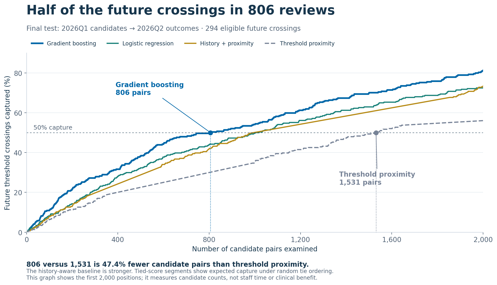

# VAERS Signal Prioritization

**Presented at**

- **2026 [AIPM](https://ww2.amstat.org/meetings/aipm/2026/index.cfm) Symposium**, UC Berkeley
- **[CHOC](https://choc.org/events/international-pediatric-and-lifespan-data-science-conference/) Hospital Pediatric and Lifespan Data Science Conference**

This project studies whether machine learning can help experts decide which vaccine–event pairs to review first. We use current reporting patterns and reporting history to predict which pairs will cross a statistical screening threshold in the following quarter.

**Main result:** in the final historical test, gradient boosting captured half of the eligible future threshold crossings within **806 ranked pairs**, compared with **1,531** for threshold proximity—**47.4% fewer pairs to examine**.

[Presentation notebook](VAERS_Presentation.ipynb) · [HTML presentation](VAERS_Presentation.html) · [Poster PDF](poster/AIPM_VAERS_Poster_2026_42x36.pdf)

The notebook contains simple explanations and executed graphs. Download the HTML file to read the presentation in a browser without running Python.

**Reproducible release:** frozen aggregate data, corrected source, saved predictions, four publication-quality graphs, the 42 × 36 poster PDF, and archived editable poster source are included. No separate data download is required for the main notebook.

## The question

VAERS contains many vaccine–event pairs, and reviewing them takes effort. We ask whether a learned ranking can identify future statistical alerts more efficiently than rankings based on current statistical scores or previous alerts.

Each observation is a **vaccine-type × MedDRA event-term pair in one quarter**. We rank pairs that appear in the current quarter but are below the screening threshold, then evaluate whether they cross it next quarter. The rule requires at least three reports, a proportional reporting ratio (PRR) of at least two, and a lower 95% confidence bound for PRR above one.

The target includes both **returning crossings** and **first observed crossings**. “First observed” means no earlier crossing in the available history beginning in 2022.

## Methods

- Build **31 features** describing reporting volume, statistical scores, report context, and recent history.
- Fit **logistic regression** and **histogram gradient boosting**, with probability calibration on a separate historical quarter.
- Compare against **threshold proximity** and **history + proximity**, which places previously crossing pairs first.
- Evaluate **nine chronological windows**, using earlier data to predict the following quarter.
- Measure average precision, capture within a fixed review budget, and performance for first and returning crossings separately.

Missing-age imputation is learned from the fitting window. Model settings are fixed, with random seed 42. The corrected pipeline is in [analysis/source/vaers_pipeline.py](analysis/source/vaers_pipeline.py).

## Results

The final test uses **6,926 candidates from 2026Q1** to predict outcomes in **2026Q2**. There are **294 positive threshold crossings**.

| Method | Average precision | Pairs examined to capture 50% |
|---|---:|---:|
| Gradient boosting | **0.2047** | **806** |
| Logistic regression | 0.1560 | 1,002 |
| History + proximity | 0.1341 | 994.24* |
| Threshold proximity | 0.0862 | 1,531 |

Average precision summarizes ranking quality; higher is better. All rows use the same eligible candidates.

*The history rule has tied scores at the cutoff. Its value is the expected number of pairs examined under uniform random ordering within ties.*



Gradient boosting exceeded threshold proximity and the history rule in all nine overall test windows, and logistic regression in seven. See the [quarterly comparison](figures/04_quarterly_performance.png).

### First observed and returning crossings

Of the 294 final-quarter positives, **245 were returning crossings** and **49 were first observed crossings**. The combined gradient-boosting top 100 captured 32 positives, all returning. Ranking only candidates with no earlier crossing captured four positives in a separate top-100 list.

Among candidates with no earlier crossing, gradient boosting achieved AP **0.0604**, compared with **0.0256** for logistic regression and **0.0115** for threshold proximity. The ranking improvement remains, but the absolute yield is modest. See the [first-versus-returning breakdown](figures/03_first_and_returning.png).

## Run the notebook

Use **Python 3.12**; the recorded numerical environment uses Python 3.12.14. From the repository root, on macOS or Linux:

```bash
python3.12 -m venv .venv
source .venv/bin/activate
python -m pip install -r requirements.txt
python run_presentation.py --in-process
```

On Windows, use `py -3.12 -m venv .venv`, then `.venv\Scripts\Activate.ps1` in PowerShell before the install and run commands. To use a notebook editor, select the `.venv` Python interpreter in VS Code or install JupyterLab separately.

The command executes every notebook cell using IPython, refits both models across all nine windows, and regenerates the notebook outputs, HTML presentation, figures, and tables. You can also open `VAERS_Presentation.ipynb` in Jupyter or VS Code and select **Run All** using the same Python environment.

The latest recorded run passed **437 numerical checks**, an exhaustive **24-permutation tie check**, and **18 presentation consistency checks**. Details are in [execution_report.json](execution_report.json).

The [GitHub Actions workflow](.github/workflows/verify.yml) runs the same full verification on pushes to `main` and pull requests. The workflow is included for execution on GitHub; a local run does not itself constitute a successful hosted Actions run.

## Data and reproducibility

The source is [VAERS public data](https://vaers.hhs.gov/data.html). The frozen quarterly panel covers **2022Q1–2026Q2** and is included with the runnable package in `analysis/inputs/`, alongside the reference results. Keep these inputs with the code when reproducing the supplied analysis.

The notebook starts from this processed panel; it does not repeat raw-report ingestion. Input and source hashes are checked before each run. Readable result tables and predictions are provided in `analysis/results/`.

See [methods](docs/METHODS.md) for the exact model settings and [data provenance](docs/DATA.md) for the data dictionary, snapshot hashes, and optional raw-data rebuild. Verify the distributed files before rerunning with `python scripts/check_manifest.py`.

| Location | Contents |
|---|---|
| `VAERS_Presentation.ipynb` | Presentation notebook with explanations and saved outputs |
| `analysis/source/` | Corrected scientific pipeline |
| `analysis/presentation.py` | Plotting and presentation helpers |
| `analysis/verify_results.py`, `analysis/verify_ties.py` | Numerical verification scripts |
| `analysis/inputs/`, `analysis/results/` | Frozen inputs and regenerated results |
| `figures/`, `tables/` | Graphs in PNG/PDF format and small CSV tables |
| `poster/` | Accepted 42 × 36 PDF; archived LaTeX, logos, and poster graphs |
| `docs/` | Methods, data dictionary, and original raw-file hashes |
| `scripts/` | Optional raw-panel reconstruction and release integrity check |
| `.github/workflows/` | Automated numerical verification |
| `CITATION.cff` | Citation metadata |

## Interpretation and next steps

These results describe **retrospective ranking performance**. Statistical threshold crossings do not establish vaccine causality or clinical usefulness. The review-count reduction measures candidate pairs, not staff time. Capture is conditional on the eligible candidate set, and the time splits do not reconstruct exact historical public-data availability.

The nine evaluation periods have already been examined and share historical data. Further work will examine stronger temporal baselines, later evaluation periods fixed before their outcomes are inspected, data availability, and first-crossing performance. Ensemble and simulation extensions remain planned work.

## Author

**Natanael Alpay** · Mathematics, University of California, Irvine  
[Website](https://alpaynatanael.github.io/) · [GitHub](https://github.com/AlpayNatanael)

For reuse and licensing status, see [NOTICE.md](NOTICE.md). For numerical issues or proposed changes, see [CONTRIBUTING.md](CONTRIBUTING.md).
